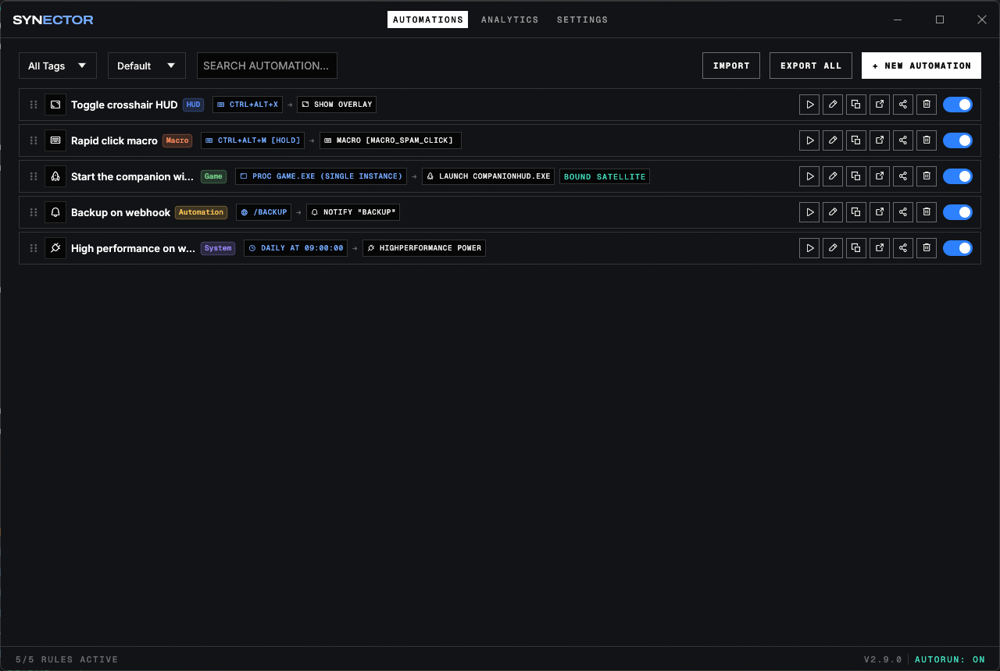
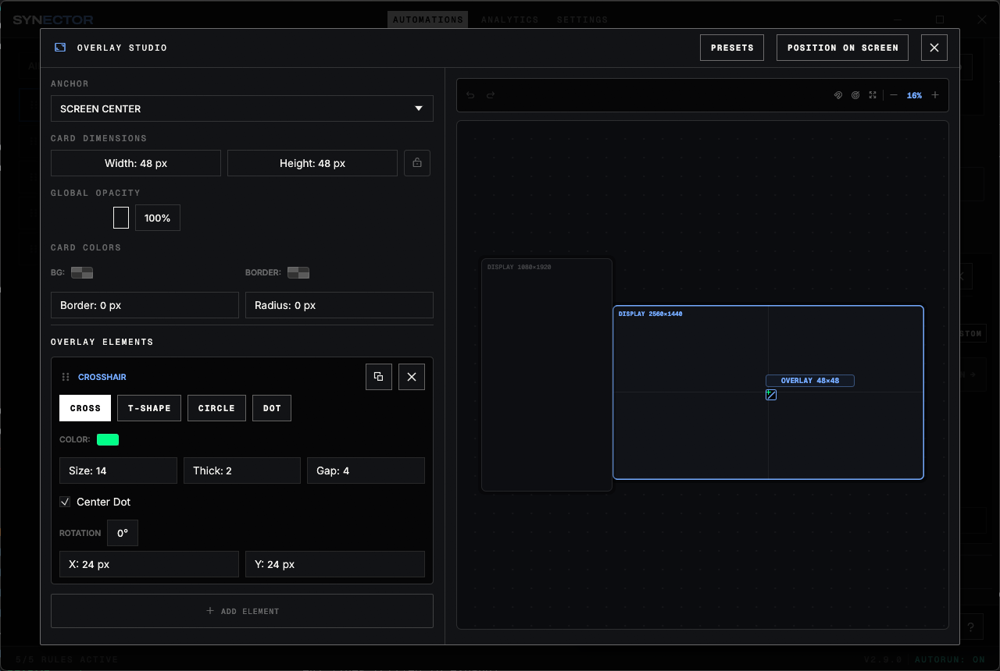
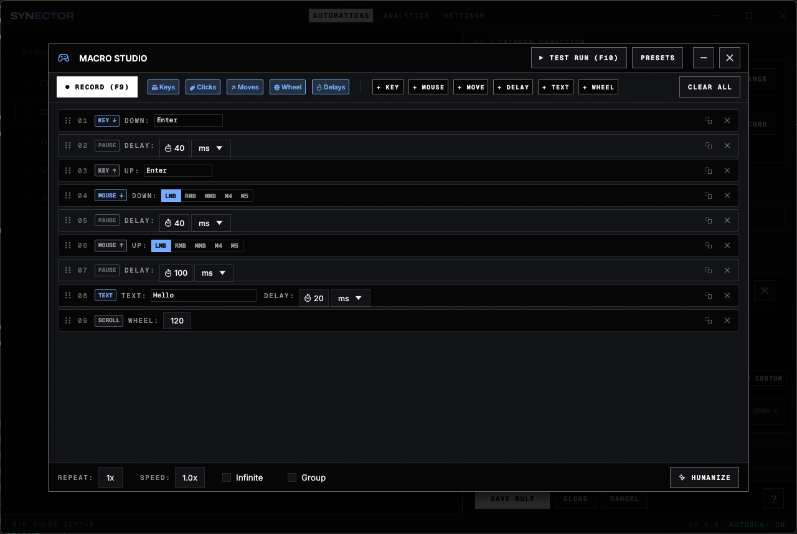
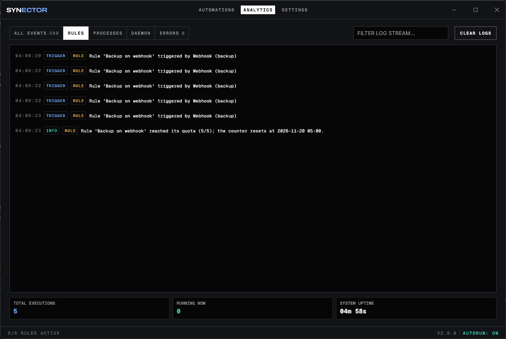

<p align="center">
  
</p>

<h1 align="center">Synector</h1>

<p align="center">Lightweight, native Windows automation suite and process supervisor built in 100% pure Rust.</p>

<p align="center">
  <a href="https://github.com/psyattack/Synector/releases/latest"></a>
  <a href="https://github.com/psyattack/Synector/releases"></a>
  <a href="https://github.com/psyattack/Synector/actions/workflows/ci.yml"></a>
  <a href="LICENSE"></a>
  <a href="https://github.com/psyattack/Synector/releases/latest"></a>
</p>

<p align="center">
  <strong>English</strong>
  ·
  <a href="README.ru.md">Русский</a>
</p>

<p align="center">
  <a href="https://psyattack.github.io/Synector/">Website</a>
  ·
  <a href="https://github.com/psyattack/Synector/releases/latest">Download</a>
  ·
  <a href="https://github.com/psyattack/Synector/issues/new">Issues</a>
</p>

> [!WARNING]
> Synector interacts directly with Windows system processes and administrative APIs. The developers are not liable for any errors, including those caused by the user, as also stated in the license.

<p align="center">
  
  <br>
  
  
</p>
<p align="center"><sub>Rules · Overlay Studio · Macro Studio · Analytics</sub></p>

## Contents

- [Overview](#overview)
- [Features](#features)
- [Installation](#installation)
- [Development](#development)
- [Configuration](#configuration)
- [Rule authoring from the CLI](#rule-authoring-from-the-cli)
- [Documentation](#documentation)
- [License](#license)
- [Credits](#credits)
- [Support & Contributing](#support--contributing)

## Overview

Synector ships as a single Windows executable with two tiers. A silent tray **daemon** owns the rule
engine, triggers, runtime counters and system monitoring around the clock. A hardware-accelerated
**GUI** (eframe/egui) is a controlling client: it edits draft rules, displays daemon state and closes
without stopping automation.

Synector talks to Windows directly: Win32 APIs, Win32 named pipes, embedded Lua and no browser
engine, bundled web runtime or telemetry. Detection is event-driven where Windows exposes an event
source — kernel ETW for process lifecycles, low-level hooks during macro recording, HTTP webhooks,
Raw Input camera deltas, power broadcasts for sleep/resume and display state, and plug-and-play
device notifications. Foreground-window focus, file changes, resource thresholds, session lock,
AC/battery power and network state are sampled with small, adaptive polling loops instead of
pretending otherwise.

## Features

* **Dual-tier, pure Rust** — the tray daemon owns rules, triggers and monitoring; close the GUI and automation keeps running with near-zero CPU.
* **Hybrid event detection** — kernel ETW process tracing when elevated, adaptive Toolhelp32 snapshot polling otherwise; both feed the same trigger surface. Global hotkeys, window focus, file watcher, HTTP webhook, sleep/resume, display on/off, device connect/disconnect, session lock/unlock, AC/battery power, user idle/active and network state.
* **Visual rule pipelines** — drag-and-drop actions with undo/redo, wait steps with timeout policies, mid-pipeline checks, If/Else branching, rule-to-rule calls and stops, toggle actions, per-rule cooldowns and lifetime or periodic execution quotas.
* **Companion process mode** — bind helper tools, HUDs or recorders to a primary game or app: they start with it, are supervised while it runs, and are terminated when it exits.
* **Overlay Studio (HUD)** — WYSIWYG GPU-accelerated overlays: crosshairs, telemetry badges, graphs, timers, media widgets, interactive controls, multi-monitor placement and `WDA_EXCLUDEFROMCAPTURE` anti-capture protection.
* **Macro Studio** — keyboard and mouse recording through low-level Windows hooks, DirectInput-compatible scan-code playback, humanized motion, Raw Input camera turns, Run/Stop/Toggle operations and reusable presets.
* **Scripting and CLI automation** — embedded Lua 5.4.9 with the `ph` API, PowerShell and Batch actions; JSON rule authoring via `--rules-apply`/`--rules-sync` with schema, template and reference discovery ([CLI reference](docs/RULE_AUTHORING.md)); `SYN1:` share codes, desktop `.lnk` shortcuts and `--run-rule`.
* **System and device control** — working-set trimming, CPU priority and affinity, firewall toggles, window actions, master/per-app volume, channel balance, audio format and default playback/recording device switching.
* **Observability** — analytics dashboard with KPI cards, real-time in-app log stream, and daily rotating log files with configurable verbosity.
* **Installer and portable builds** — a native Windows installer with an uninstaller, Start Menu shortcut and `App Paths` integration, or a single portable executable. Both update themselves through daemon-managed GitHub release checks with SHA-256 verification, tray progress and optional auto-install.

## Installation

Requires Windows 10 / 11 (x64).

- **Setup** — `Synector-Setup-<version>-Windows-x64.exe` from [**GitHub Releases**](https://github.com/psyattack/Synector/releases/latest).
- **Portable** — `Synector-v<version>-Windows-x64.zip`: extract anywhere and run `Synector.exe`.
- **Installer script** — one line in PowerShell: `irm https://raw.githubusercontent.com/psyattack/Synector/main/installer/install.ps1 | iex`.

Every release also publishes `SHA256SUMS.txt`; compare it with `Get-FileHash -Algorithm SHA256` when
you verify a download manually. SmartScreen prompts, elevation and update questions are covered in
[docs/FAQ.md](docs/FAQ.md#installation-and-updates).

> [!IMPORTANT]
> **Administrator Privileges**: Synector launches elevated by default (override with `--no-elevate`). Required for:
> * **Kernel ETW**: zero-polling, real-time process lifecycle events.
> * **UIPI Bypass**: hardware input simulation into elevated games and apps.
> * **Process Control & Autostart**: memory/affinity tuning and silent elevated logon via Task Scheduler.

> [!NOTE]
> The daemon registers a Task Scheduler autostart entry on first launch (configurable in Settings).

## Development

Requires a recent stable Rust toolchain on Windows; the `eframe`/`egui` 0.37 dependencies currently
need Rust **1.95 or newer**. The project does not pin an MSRV.

Contribution workflow, code style and documentation rules live in [CONTRIBUTING.md](CONTRIBUTING.md).

```powershell
# Clone the repository
git clone https://github.com/psyattack/Synector.git
cd Synector

# Compile and run all unit tests
cargo check
cargo test

# Lint gate used by CI (warnings are errors)
cargo clippy -- -D warnings

# Run in development mode (spawns the daemon and opens the GUI)
cargo run

# Run only the background daemon (tray mode)
cargo run -- --daemon

# Open the GUI (starts the daemon if it is not running)
cargo run -- --gui

# Print daemon status over the named pipe
cargo run -- --status

# Build the optimized release binary
cargo build --release
```

CI (`.github/workflows/ci.yml`) runs `cargo check`, `cargo test` and `cargo clippy -- -D warnings`
on `windows-latest`.

### Stack

- **UI:** egui / eframe, egui_extras, egui-pop-phosphor (egui 0.37 fork of egui-phosphor)
- **Runtime:** Tokio
- **Engine:** mlua (vendored Lua 5.4.9), windows-rs
- **Data:** Serde / Serde JSON, schemars
- **Networking:** reqwest + rustls
- **Compression and hashing:** brotli, flate2, zip, sha2

### Project structure

```
Synector/
├── .github/                # CI, release workflow, issue and PR templates
├── assets/                 # Icon, logo, screenshots and bundled fonts
├── docs/                   # Documentation set, indexed in docs/README.md
├── installer/              # Inno Setup script and console bootstrap
├── src/                    # Rust sources: daemon, GUI, IPC, CLI, domain model, i18n
├── build.rs                # Windows resources: icon, version, manifest
├── Cargo.lock              # Pinned dependency versions
├── Cargo.toml              # Manifest and dependencies
├── CHANGELOG.md            # Release history
├── CODE_OF_CONDUCT.md      # Community standards
├── CONTRIBUTING.md         # Build, style and pull-request process
├── LICENSE                 # MIT license
├── README.md               # This file
├── README.ru.md            # Russian README
├── SECURITY.md             # Vulnerability reporting
└── NOTICES.md              # Third-party dependencies and license texts
```

The tree stops at the top level on purpose: per-file responsibilities change faster than this
document. Module-level pointers live in [CONTRIBUTING.md](CONTRIBUTING.md) ("Where changes belong"),
and how the pieces behave and interact — the two tiers, the data flow, the rule engine, overlays,
input simulation and process monitoring — is described in
[docs/ARCHITECTURE.md](docs/ARCHITECTURE.md).

## Configuration

All user files live in **`%LOCALAPPDATA%\Synector\`**. Set `SYNECTOR_CONFIG_DIR` to relocate the whole
directory for portable or isolated runs.

| File / folder | Contents |
|---|---|
| `settings.json` | Window geometry, tray visibility, daemon masking, language, theme and update preferences |
| `rules.json` | Automation rule definitions (runtime counters are written zeroed) |
| `library.json` | Overlay and macro presets |
| `runtime.json` | Per-rule execution counters, last-run timestamps and custom quota-window anchors |
| `logs\` | Daily diagnostic logs, one file per day, 7-day retention and an 8 MiB cap per file |

Writes are atomic and versioned, and while the daemon is reachable it is the only writer — back up or
edit these files with Synector stopped. The write path, the quarantine of a section that fails to
parse, read caches and coalescing rules are documented in
[docs/ARCHITECTURE.md#configuration-storage](docs/ARCHITECTURE.md#configuration-storage).

### Settings fields

`settings.json` holds the preferences the app does not derive from the GUI state:

| Field | Type | Meaning |
|---|---|---|
| `version` | integer | Schema version, rewritten on every save — leave it alone |
| `window` | object | Saved main-window geometry and state; managed by the app |
| `tray_icon_path` | string, optional | Custom tray icon file; the field is omitted while unset |
| `hide_tray_icon` | boolean (default `false`) | Hide the tray icon |
| `mask_daemon_process` | boolean (default `false`) | Run the daemon from the masked `WindowsServiceHost.exe` copy |
| `language` | `"english"` or `"russian"` (default `"english"`) | Interface language |
| `check_updates_on_startup` | boolean (default `true`) | Check GitHub for a new release at startup |
| `auto_install_updates` | boolean (default `false`) | Install a downloaded update without asking |
| `theme` | `"dark"`, `"light"` or `"chocolate"` (default `"dark"`) | Interface palette |

## Rule authoring from the CLI

Rules are plain JSON and can be validated, applied, replaced, exported, shared and reset without
opening the GUI:

```powershell
cmd /c "Synector.exe --rules-schema > schema.json"
cmd /c "Synector.exe --rules-template schedule:play_sound > rule.json"
cmd /c "Synector.exe --rules-validate rule.json"
cmd /c "Synector.exe --rules-apply rule.json"
cmd /c "Synector.exe --rules-sync rule.json --dry-run --json"
cmd /c "Synector.exe --rules-share my_rule"
```

`Synector.exe` is a Windows GUI-subsystem executable, so PowerShell neither waits for it nor captures
its output; `cmd /c` does both (see [console notes](docs/RULE_AUTHORING.md#console-notes)).

See [docs/RULE_AUTHORING.md](docs/RULE_AUTHORING.md) for the full command reference, quota semantics,
JSON report shapes and `SYN1:` share-code behavior, and [docs/EXAMPLES.md](docs/EXAMPLES.md) for
complete recipes you can validate and apply.

## Documentation

The full map — which document owns what and who it is for — lives in [docs/README.md](docs/README.md).
Entry points: [FAQ](docs/FAQ.md) for troubleshooting, [RULE_AUTHORING](docs/RULE_AUTHORING.md) for the
CLI and the JSON format, [SCRIPTING](docs/SCRIPTING.md) for Lua, [EXAMPLES](docs/EXAMPLES.md) for
ready-to-apply recipes, [ARCHITECTURE](docs/ARCHITECTURE.md) for internals,
[CONTRIBUTING](CONTRIBUTING.md) for the build and review process, and
[RELEASING](docs/RELEASING.md) for how versions are cut.

## License

This project is licensed under the [MIT License](LICENSE). Third-party components:
[NOTICES.md](NOTICES.md).

## Credits

- **UI/UX Idea:** [ArtCraft Launcher](https://github.com/storytold/craft-launcher)

## Support & Contributing

- **Bugs and feature requests:** open an issue on
  [**GitHub Issues**](https://github.com/psyattack/Synector/issues/new/choose). Include the Synector
  version, `winver`, whether the app was elevated, reproduction steps and relevant log lines with
  secrets removed.
- **Questions and troubleshooting:** see [docs/FAQ.md](docs/FAQ.md).
- **Contributing:** the build, style and review process is in [CONTRIBUTING.md](CONTRIBUTING.md);
  community standards are in [CODE_OF_CONDUCT.md](CODE_OF_CONDUCT.md).
- **Security:** report privately as described in [SECURITY.md](SECURITY.md). Do not open a public
  issue for a vulnerability.
