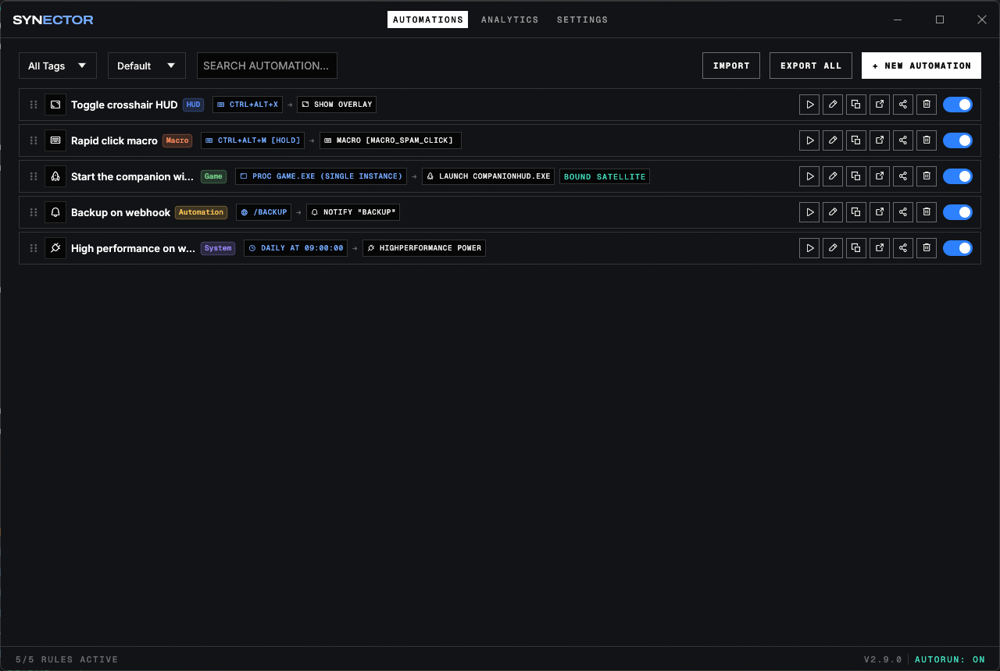
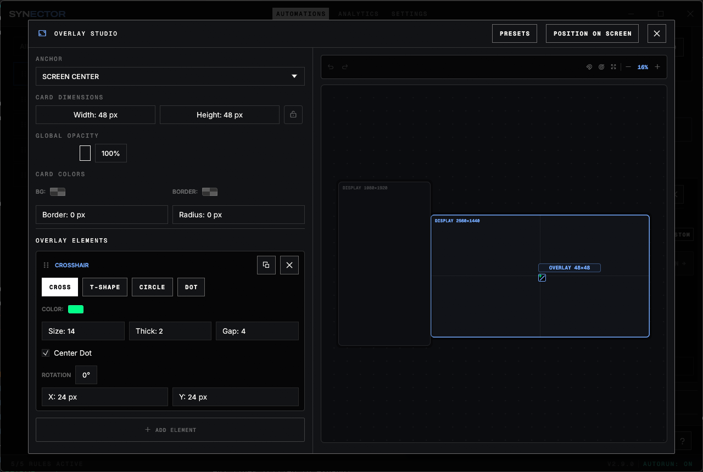
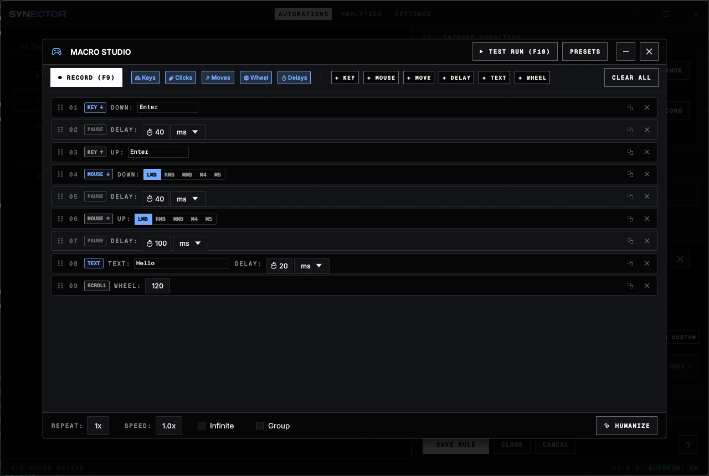
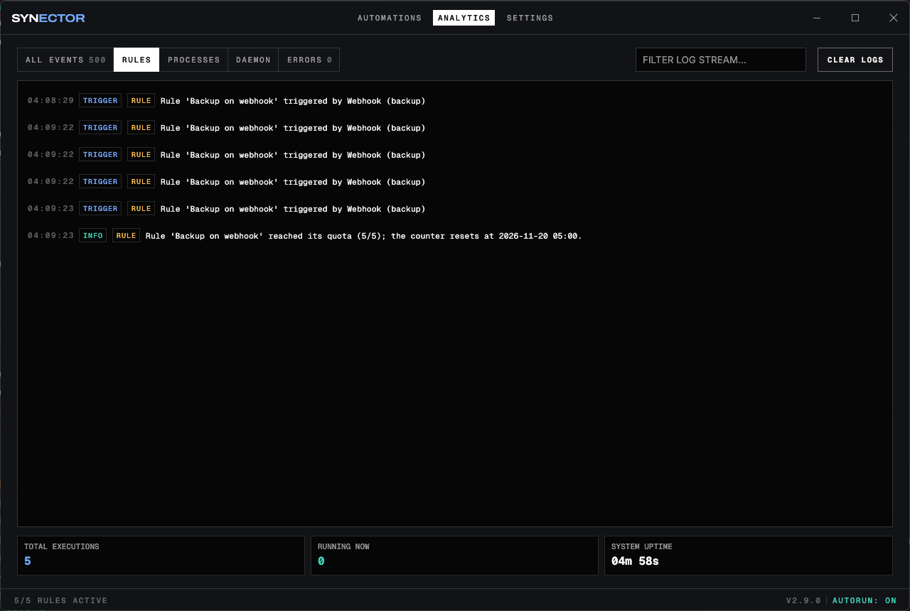

<p align="center">
  
</p>

<h1 align="center">Synector</h1>

<p align="center">Лёгкий нативный набор автоматизации Windows и супервизор процессов, написанный на 100% чистом Rust.</p>

<p align="center">
  <a href="https://github.com/psyattack/Synector/releases/latest"></a>
  <a href="https://github.com/psyattack/Synector/releases"></a>
  <a href="https://github.com/psyattack/Synector/actions/workflows/ci.yml"></a>
  <a href="LICENSE"></a>
  <a href="https://github.com/psyattack/Synector/releases/latest"></a>
</p>

<p align="center">
  <a href="README.md">English</a>
  ·
  <strong>Русский</strong>
</p>

<p align="center">
  <a href="https://psyattack.github.io/Synector/?lang=ru">Сайт</a>
  ·
  <a href="https://github.com/psyattack/Synector/releases/latest">Скачать</a>
  ·
  <a href="https://github.com/psyattack/Synector/issues/new">Issues</a>
</p>

> [!WARNING]
> Synector напрямую взаимодействует с системными процессами Windows и административными API. Разработчики не несут ответственности за любые ошибки, в том числе вызванные пользователем, как указано в лицензии.

<p align="center">
  
  <br>
  
  
</p>
<p align="center"><sub>Правила · Overlay Studio · Macro Studio · Аналитика</sub></p>

## Содержание

- [Обзор](#обзор)
- [Возможности](#возможности)
- [Установка](#установка)
- [Разработка](#разработка)
- [Конфигурация](#конфигурация)
- [Авторство правил из CLI](#авторство-правил-из-cli)
- [Документация](#документация)
- [Лицензия](#лицензия)
- [Благодарности](#благодарности)
- [Поддержка и участие](#поддержка-и-участие)

## Обзор

Synector поставляется одним исполняемым файлом Windows с двумя уровнями. Тихий **демон** в трее
круглосуточно владеет движком правил, триггерами, счётчиками времени выполнения и мониторингом
системы. Аппаратно-ускоренный **GUI** (eframe/egui) — управляющий клиент: он редактирует черновики
правил, показывает состояние демона и закрывается, не останавливая автоматизацию.

Synector общается с Windows напрямую: Win32 API, именованные каналы Win32, встроенный Lua — без
браузерного движка, встроенного веб-рантайма и телеметрии. Обнаружение событийное там, где Windows
предоставляет источник событий: ETW ядра для жизненного цикла процессов, низкоуровневые хуки при
записи макросов, HTTP-webhook, дельты камеры через Raw Input, широковещательные сообщения о питании
для сна и пробуждения, состояния дисплея и уведомления Plug and Play об устройствах. Фокус активного
окна, изменения файлов, пороги ресурсов, блокировка сеанса, питание от сети или батареи и состояние
сети опрашиваются небольшими адаптивными циклами — без попыток выдать опрос за событие.

## Возможности

* **Два уровня на чистом Rust** — демон в трее владеет правилами, триггерами и мониторингом;
  закройте GUI, и автоматизация продолжит работать почти без нагрузки на CPU.
* **Гибридное обнаружение событий** — трассировка процессов через ETW ядра при повышенных правах
  и адаптивный опрос снимков Toolhelp32 без них; оба пути питают одну и ту же поверхность
  триггеров. Глобальные горячие клавиши, фокус окна, наблюдение за файлами, HTTP-webhook,
  сон/пробуждение, включение и выключение дисплея, подключение и отключение устройств, блокировка
  и разблокировка сеанса, питание от сети или батареи, простой и активность пользователя, состояние
  сети.
* **Визуальные конвейеры действий** — перетаскивание действий с отменой и повтором, шаги ожидания
  с политикой тайм-аута, проверки в середине конвейера, ветвление If/Else, вызов и остановка
  других правил, ожидания и проверки активности пайплайна другого правила, действия-переключатели,
  кулдауны правил и пожизненные или периодические квоты выполнения.
* **Режим сопутствующих процессов** — привязывайте вспомогательные инструменты, HUD или рекордеры
  к основной игре или приложению: они запускаются вместе с ней, контролируются во время работы и
  завершаются при её выходе.
* **Overlay Studio (HUD)** — WYSIWYG-оверлеи с GPU-ускорением: прицелы, телеметрические бейджи,
  графики, таймеры, медиа-виджеты, интерактивные элементы управления, размещение на нескольких
  мониторах и защита от захвата экрана `WDA_EXCLUDEFROMCAPTURE`.
* **Macro Studio** — запись клавиатуры и мыши через низкоуровневые хуки Windows, воспроизведение
  скан-кодами, совместимое с DirectInput, очеловеченное движение, повороты камеры через Raw Input,
  операции Run/Stop/Toggle и переиспользуемые пресеты.
* **Скрипты и автоматизация из CLI** — встроенный Lua 5.4.9 с API `syn`, действия PowerShell и Batch;
  авторство правил в JSON через `--rules-apply`/`--rules-sync` со схемой, шаблонами и справочником
  ([справочник CLI](docs/RULE_AUTHORING.md)); share-коды `SYN1:`, ярлыки `.lnk` на рабочем столе и
  `--run-rule`.
* **Управление системой и устройствами** — обрезка рабочего набора, приоритет и сродство CPU,
  переключение брандмауэра, действия с окнами, общая громкость и громкость приложений, баланс
  каналов, формат звука и переключение устройств воспроизведения и записи по умолчанию.
* **Наблюдаемость** — панель аналитики с KPI-карточками, поток логов в реальном времени и суточные
  ротируемые файлы логов с настраиваемой подробностью.
* **Установщик и портативные сборки** — нативный установщик Windows с деинсталлятором, ярлыком в
  меню «Пуск» и интеграцией `App Paths`, либо один портативный исполняемый файл. Обе формы
  обновляются сами через управляемую демоном проверку релизов GitHub с проверкой SHA-256,
  прогрессом в трее и необязательной автоустановкой.

## Установка

Требуется Windows 10 / 11 (x64).

- **Установщик** — `Synector-Setup-<version>-Windows-x64.exe` из
  [**релизов GitHub**](https://github.com/psyattack/Synector/releases/latest).
- **Портативная версия** — `Synector-v<version>-Windows-x64.zip`: распакуйте в любую папку и
  запустите `Synector.exe`.
- **Скрипт установки** — одна строка в PowerShell:
  `irm https://raw.githubusercontent.com/psyattack/Synector/main/installer/install.ps1 | iex`.

Каждый релиз также публикует `SHA256SUMS.txt`; сравните его с результатом
`Get-FileHash -Algorithm SHA256`, если проверяете загрузку вручную. Предупреждения SmartScreen,
повышенные права и вопросы об обновлениях разобраны в
[docs/FAQ.md](docs/FAQ.md#installation-and-updates) (на английском).

> [!IMPORTANT]
> **Права администратора**: Synector по умолчанию запускается с повышенными правами (отключить
> можно флагом `--no-elevate`). Это необходимо для:
> * **ETW ядра** — событий жизненного цикла процессов без опроса в реальном времени.
> * **Обхода UIPI** — аппаратной симуляции ввода в приложения и игры с повышенными правами.
> * **Управления процессами и автозапуска** — настройки памяти и сродства, а также тихого
>   автозапуска с наивысшими правами через Планировщик заданий.

> [!NOTE]
> При первом запуске демон создаёт задачу автозапуска в Планировщике заданий (настраивается в
> настройках).

## Разработка

Требуется свежий стабильный инструментарий Rust на Windows; текущим зависимостям
`eframe`/`egui` 0.37 нужен Rust **1.95 или новее**. Проект не фиксирует MSRV.

Процесс участия, стиль кода и правила документации описаны в [CONTRIBUTING.md](CONTRIBUTING.md)
(на английском).

```powershell
# Клонировать репозиторий
git clone https://github.com/psyattack/Synector.git
cd Synector

# Проверить сборку и запустить все модульные тесты
cargo check
cargo test

# Линт-проверка, используемая в CI (предупреждения считаются ошибками)
cargo clippy -- -D warnings

# Запуск в режиме разработки (поднимает демон и открывает GUI)
cargo run

# Только фоновый демон (режим трея)
cargo run -- --daemon

# GUI (демон запустится, если он ещё не запущен)
cargo run -- --gui

# Статус демона по именованному каналу
cargo run -- --status

# Оптимизированная release-сборка
cargo build --release
```

CI (`.github/workflows/ci.yml`) запускает `cargo check`, `cargo test` и `cargo clippy -- -D warnings`
на `windows-latest`.

### Стек

- **UI:** egui / eframe, egui_extras, egui-pop-phosphor (egui 0.37 fork of egui-phosphor)
- **Рантайм:** Tokio
- **Движок:** mlua (встроенный Lua 5.4.9), windows-rs
- **Данные:** Serde / Serde JSON, schemars
- **Сеть:** reqwest + rustls
- **Сжатие и хеширование:** brotli, flate2, zip, sha2

### Структура проекта

```
Synector/
├── .github/                # CI, релизный workflow, шаблоны issue и PR
├── assets/                 # Иконка, логотип, скриншоты и встроенные шрифты
├── docs/                   # Документация, индекс в docs/README.md
├── installer/              # Скрипт Inno Setup и консольный загрузчик
├── src/                    # Исходники Rust: демон, GUI, IPC, CLI, доменная модель, i18n
├── build.rs                # Ресурсы Windows: иконка, VERSIONINFO, манифест
├── Cargo.lock              # Зафиксированные версии зависимостей
├── Cargo.toml              # Манифест и зависимости
├── CHANGELOG.md            # История релизов
├── CODE_OF_CONDUCT.md      # Стандарты сообщества
├── CONTRIBUTING.md         # Сборка, стиль и процесс pull request
├── LICENSE                 # Лицензия MIT
├── README.md               # Английская версия этого файла
├── README.ru.md            # Этот файл
├── SECURITY.md             # Политика сообщения об уязвимостях
└── NOTICES.md              # Зависимости третьих сторон и тексты лицензий
```

Дерево намеренно ограничено верхним уровнем: ответственность файлов меняется быстрее этого
документа. Указатели по модулям — в [CONTRIBUTING.md](CONTRIBUTING.md) («Where changes belong»),
а как части ведут себя и взаимодействуют — два уровня, поток данных, движок правил, оверлеи,
симуляция ввода и мониторинг процессов — описано в
[docs/ARCHITECTURE.md](docs/ARCHITECTURE.md) (на английском).

## Конфигурация

Все пользовательские файлы лежат в **`%LOCALAPPDATA%\Synector\`**. Переменная
`SYNECTOR_CONFIG_DIR` переносит весь каталог для портативных или изолированных запусков.

| Файл / папка | Содержимое |
|---|---|
| `settings.json` | Геометрия окна, видимость трея, маскировка демона, язык, палитра, скин, акцент и параметры обновлений |
| `rules.json` | Определения правил (счётчики времени выполнения записываются обнулёнными) |
| `library.json` | Пресеты оверлеев и макросов |
| `runtime.json` | Счётчики выполнений правил, время последнего запуска и якоря пользовательских окон квот |
| `logs\` | Суточные диагностические логи, хранение 7 дней и лимит 8 МиБ на файл |

Запись атомарна и версионирована, и пока демон доступен, пишет только он — резервные копии и правки
делайте при остановленном Synector. Секция, записанная более новой сборкой Synector, читается, но
никогда не перезаписывается старой сборкой, поэтому откат версии не перепишет её молча. Путь
записи, карантин нечитаемой секции, кеши чтения и правила объединения записей описаны в
[docs/ARCHITECTURE.md#configuration-storage](docs/ARCHITECTURE.md#configuration-storage).

### Поля settings.json

`settings.json` хранит настройки, которые приложение не выводит из состояния интерфейса:

| Поле | Тип | Значение |
|---|---|---|
| `version` | целое | Версия схемы, перезаписывается при каждом сохранении — не трогайте |
| `window` | объект | Сохранённые геометрия и состояние главного окна; управляется приложением |
| `tray_icon_path` | строка, необязательно | Файл пользовательской иконки трея; пока не задан, поле отсутствует |
| `hide_tray_icon` | логическое (по умолчанию `false`) | Скрыть иконку в трее |
| `mask_daemon_process` | логическое (по умолчанию `false`) | Запускать демон из маскированной копии `WindowsServiceHost.exe`; изменения применяются после перезапуска Synector |
| `language` | `"english"` или `"russian"` (по умолчанию `"english"`) | Язык интерфейса |
| `check_updates_on_startup` | логическое (по умолчанию `true`) | Проверять новый релиз на GitHub при запуске |
| `auto_install_updates` | логическое (по умолчанию `false`) | Устанавливать скачанное обновление без подтверждения |
| `theme` | `"dark"` или `"light"` (по умолчанию `"dark"`) | Палитра интерфейса |
| `ui_skin` | `"modern"` или `"classic"` (по умолчанию `"modern"`) | Поколение интерфейса: современный вид или прежний |
| `accent` | строка, необязательно | Акцентный цвет (`"#rrggbb"`) для выделения, фокуса и активных элементов; если не задан — акцент палитры |

## Авторство правил из CLI

Правила — это обычный JSON, который можно проверять, применять, заменять, экспортировать,
передавать и сбрасывать без открытия GUI:

```powershell
cmd /c "Synector.exe --rules-schema > schema.json"
cmd /c "Synector.exe --rules-template schedule:play_sound > rule.json"
cmd /c "Synector.exe --rules-validate rule.json"
cmd /c "Synector.exe --rules-apply rule.json"
cmd /c "Synector.exe --rules-sync rule.json --dry-run --json"
cmd /c "Synector.exe --rules-share my_rule"
```

`Synector.exe` — исполняемый файл Windows с GUI-подсистемой, поэтому PowerShell не дожидается его
завершения и не перехватывает вывод; `cmd /c` делает и то и другое
([заметки о консоли](docs/RULE_AUTHORING.md#console-notes)).

Полный справочник команд, семантику квот, форматы JSON-отчётов и поведение share-кодов `SYN1:`
смотрите в [docs/RULE_AUTHORING.md](docs/RULE_AUTHORING.md), а готовые рецепты — в
[docs/EXAMPLES.md](docs/EXAMPLES.md).

## Документация

Полная карта — какой документ что освещает и для кого он — в [docs/README.md](docs/README.md).
Точки входа: [FAQ](docs/FAQ.md) — неполадки, [RULE_AUTHORING](docs/RULE_AUTHORING.md) — CLI и
формат JSON, [SCRIPTING](docs/SCRIPTING.md) — Lua, [EXAMPLES](docs/EXAMPLES.md) — готовые рецепты,
[ARCHITECTURE](docs/ARCHITECTURE.md) — внутреннее устройство,
[CONTRIBUTING](CONTRIBUTING.md) — сборка и ревью, [RELEASING](docs/RELEASING.md) — как выпускается
версия.

Документация в `docs/` и большинство файлов сообщества написаны на английском.

## Лицензия

Проект распространяется по [лицензии MIT](LICENSE). Компоненты третьих сторон:
[NOTICES.md](NOTICES.md).

## Благодарности

- **Идея UI/UX:** [ArtCraft Launcher](https://github.com/storytold/craft-launcher)

## Поддержка и участие

- **Ошибки и предложения:** создайте issue в
  [**GitHub Issues**](https://github.com/psyattack/Synector/issues/new/choose). Укажите версию
  Synector, `winver`, запускалось ли приложение с повышенными правами, шаги воспроизведения и
  относящиеся к делу строки лога без секретов.
- **Вопросы и неполадки:** см. [docs/FAQ.md](docs/FAQ.md).
- **Участие в разработке:** процесс сборки, стиль и ревью описаны в
  [CONTRIBUTING.md](CONTRIBUTING.md); стандарты сообщества — в
  [CODE_OF_CONDUCT.md](CODE_OF_CONDUCT.md).
- **Безопасность:** сообщайте приватно, как описано в [SECURITY.md](SECURITY.md). Не открывайте
  публичный issue об уязвимости.
